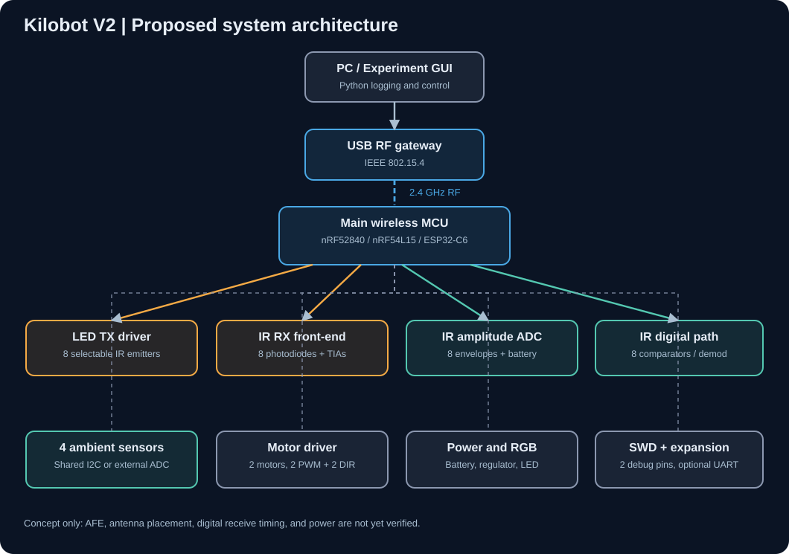
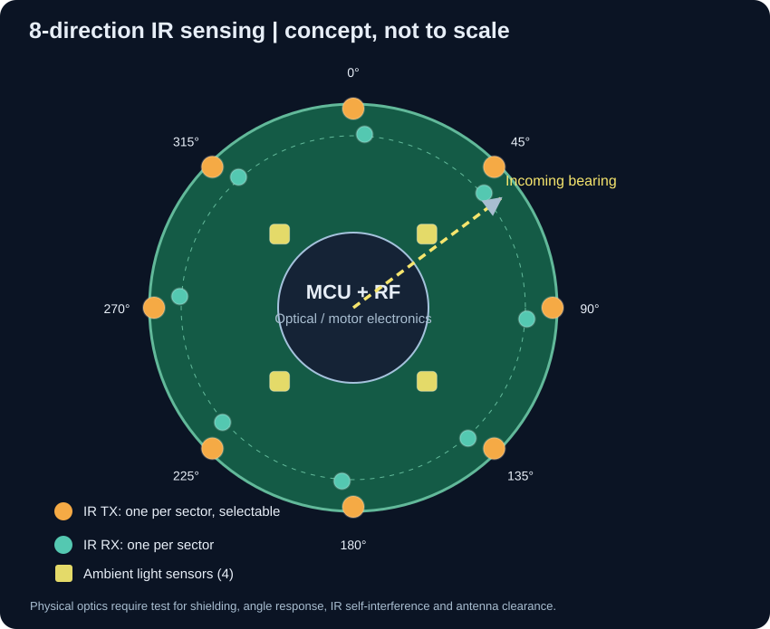
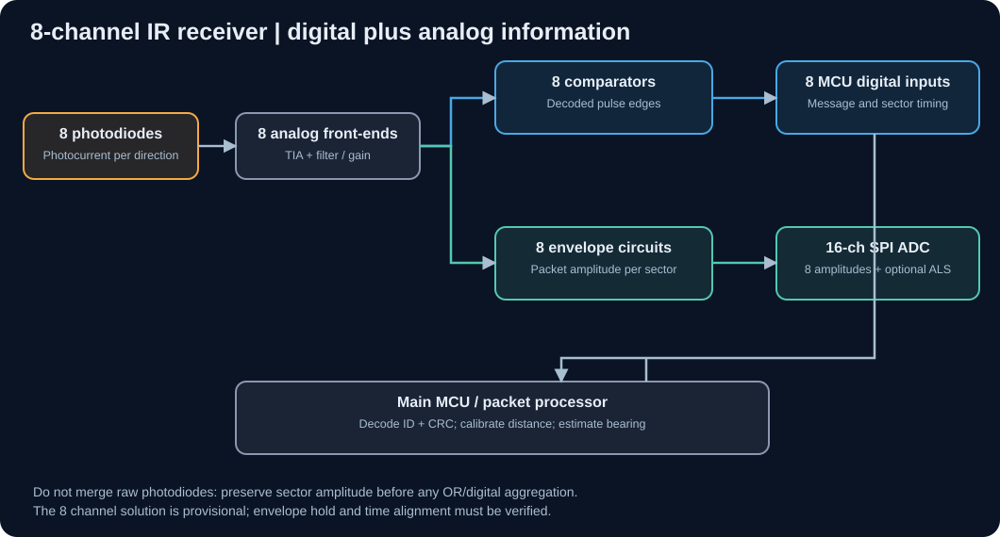
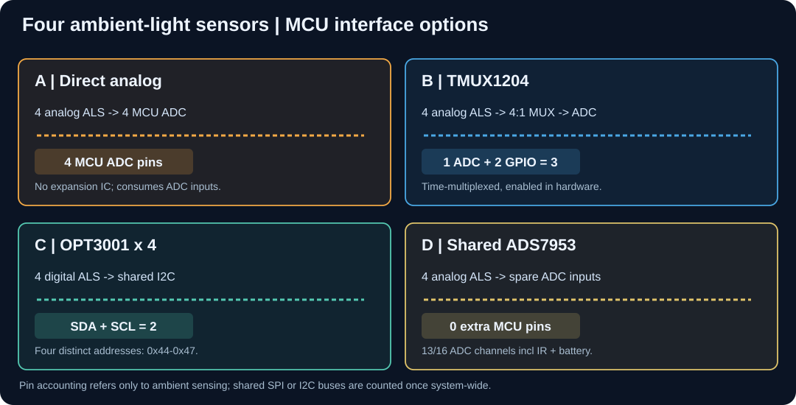
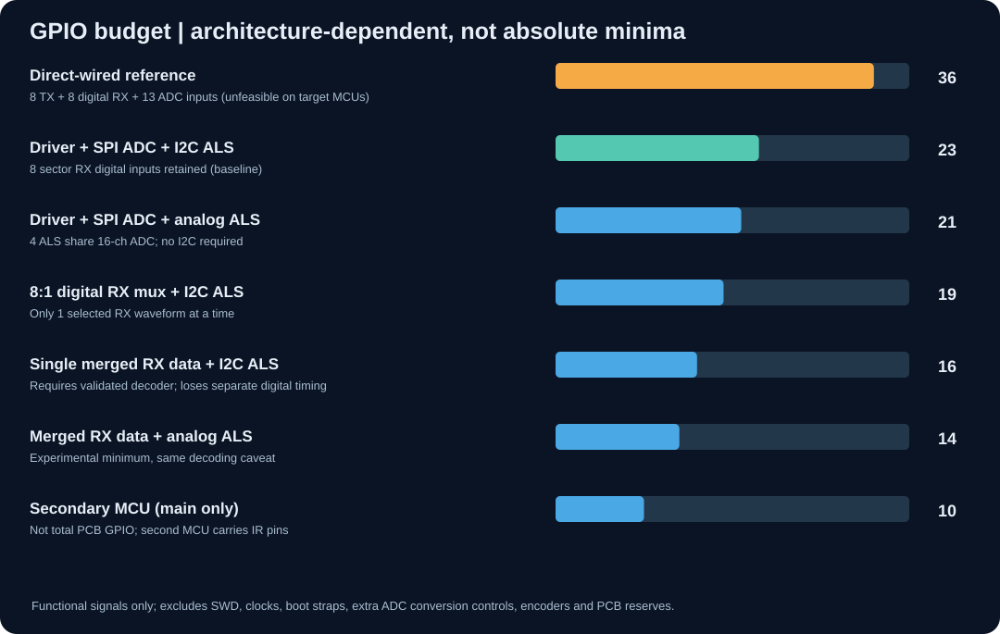

# Kilobot V2 — Hardware Architecture, IR System & Processor Selection

**Status:** Preliminary design defense / research notebook (not a final PCB schematic)  
**Prepared:** 18 November 2026  
**Language:** English with short Chinese notes  
**Proposed baseline:** A Nordic nRF52840-based wireless robot, physical directional IR for neighboring robots, and four ambient-light sensors. Locomotion remains open.

> **Central recommendation:** Choose architecture and *verified functional pin needs* before committing to an MCU package. A nominal 23-GPIO architecture is feasible; reducing pins further is possible, but may sacrifice independently timed IR reception. GPIO is not the only constraint: ADC-capable pins, interrupts, timers, RF antenna layout, energy and optical front-end circuitry matter equally.
>
> **中文摘要：** 推荐先确定 IR 和环境光传感器的实际信号需求，再选主控封装。23 是一种方案的估算，不是所有设计的固定要求。尤其要保留 IR 的模拟幅值信息，才能做测距和方向估计。

## Table of contents

1. [Architecture overview](#1-architecture-overview)
2. [Eight-direction IR geometry](#2-eight-direction-ir-geometry)
3. [IR transmission and the LED driver](#3-ir-transmission-and-the-led-driver)
4. [IR reception: messages, range and bearing](#4-ir-reception-messages-range-and-bearing)
5. [Four ambient-light sensors](#5-four-ambient-light-sensors)
6. [Motor and mechanical interface](#6-motor-and-mechanical-interface)
7. [Detailed functional GPIO budget](#7-detailed-functional-gpio-budget)
8. [MCU candidates and cost](#8-mcu-candidates-and-cost)
9. [System communication and firmware](#9-system-communication-and-firmware)
10. [Risk register and verification plan](#10-risk-register-and-verification-plan)
11. [Meeting defense](#11-meeting-defense)
12. [Component links and image gallery](#12-component-links-and-image-gallery)
13. [Datasheets and references](#13-datasheets-and-references)

---

## 1. Architecture overview

**Figure 1 — Original architecture drawing for this report.** The gateway is shared by the swarm; everything inside a robot is repeated per robot. Not a pin-level schematic.

| Subsystem | Baseline concept | Essential reason |
|---|---|---|
| Main MCU | Nordic nRF52840 (evaluate nRF54L15, ESP32-C6) | Integrated IEEE 802.15.4 radio, timers, DMA and GPIO |
| Global network | PC → USB → compatible 802.15.4 radio gateway → robots | Control, broadcast, individual addressing, telemetry |
| IR TX | Eight outward-facing IR emitters; selectable sector mask | Local physical optical messages; optional direction-specific TX |
| IR RX | Eight directional photodiodes + signal conditioning | Distinguish neighboring robots' direction |
| IR digital path | Demodulation/comparator → digital receive signal(s) | Recover packet bits and timing |
| IR analog path | TIA + filter / envelope or peak hold → ADC | Compare amplitude for distance and bearing |
| Ambient light | Four OPT3001 digital sensors on shared I²C, or four analog sensors | Light-gradient experiments |
| Locomotion | Dual motor driver; physical form TBD | Differential-drive option, not committed |
| Support | Battery, charger, regulator, RGB LED, SWD, antenna keep-out | Reliable experiments and recovery |

**Two distinct protocols** (两套通信):
- **RF:** IEEE 802.15.4 is already a standard. We define our *application messages* (e.g., START, STOP, GET_STATUS, telemetry); we do not implement the radio physical layer from scratch.
- **IR:** We must choose or adapt optical modulation, frame coding, error detection, collision handling and ranging/bearing algorithms. Reuse of the original Kilobot IR approach is worth studying.

**Not finalized:** robot size/legs/wheels; IR carrier and bit rate; optical emitter/detector models; 8 independent digital receive channels vs merged receive path; MCU package; OTA bootloader. Hardware blocks shown as "proposed" do not imply proven compatibility.

## 2. Eight-direction IR geometry

**Figure 2 — Original concept diagram.** Eight sectors at 45-degree angular spacing; one transmitter and one receiver per sector; four ambient-light sensors are shown separately.

### Do we need eight *directional transmitters*?

**Not strictly for receiving-side bearing estimation.** A robot can transmit the same message in every direction, while the receiver estimates incoming direction using directional sensitivity. But eight *selectable* transmitters are useful when we want:
- all-around local broadcast (enable all eight);
- sector-specific experiments or directed optical transmission (enable one or more);
- optical power management and reduced interference;
- calibration of direction-dependent coverage.

**Recommended compromise:** place up to eight IR LEDs around the rim, but send **one common modulated data stream** through selected LEDs. The direction mask is software-controlled and changes more slowly than the data carrier.

**Important:** Sector angle is not equivalent to a measured bearing. Lens width, PCB occlusion, reflections and orientation errors produce overlapping and distorted angular response curves. Calibrate each channel.

### Do we really need eight receivers?

Eight improves angular coverage compared with three or four, but it is not magically required for all swarm behaviors. The number should follow the desired angular resolution, robot diameter, optical field of view, signal-to-noise ratio and circuit cost. Start by testing 4 vs 8 directional channels on a prototype. A *single* omnidirectional receiver can decode messages, but generally cannot estimate bearing from directional amplitude by itself.

## 3. IR transmission and the LED driver

### 3.1 What signal is sent?

At the physical level, an IR LED emits light in response to **current**. The MCU generates data timing, typically with a hardware timer/PWM. A driver provides controlled LED current. Example, *illustrative* only:

~~~text
MCU bitstream / carrier -> gate / driver -> IR LED -> free-space light
        101101...                             (nearby robot)
~~~

A carrier-based OOK implementation is one possibility; **carrier frequency, bit rate, packet coding and burst length remain TBD**. Do not automatically assume that ordinary TV-remote receivers will preserve signal strength or support the selected data rate.

### 3.2 Candidate: TI TLC59282

- [TI TLC59282 product and datasheet](https://www.ti.com/product/TLC59282)
- 16 constant-current **sink** channels with on/off control; eight outputs can be used for eight IR LEDs.
- Serial interface selects the output mask. After loading data, LATCH applies the selection.
- BLANK disables all active outputs; its timing could potentially gate a **common modulation waveform**.
- TI specifies a maximum sink current of **35 mA per channel when VCC ≤ 3.6 V**, or **45 mA per channel at higher VCC** within the stated conditions.
- **It is not an IR protocol chip.** It does not encode packets or measure light. The main MCU still generates timing; the 35 mA-class drive may or may not meet our optical-range requirements.

**Electrical feasibility, not yet experimentally proven:** drive appropriate IR LED anodes from a suitable supply; connect cathodes to constant-current sink outputs; use DIN, SCLK, LATCH and BLANK control; verify current regulation, thermal dissipation, carrier duty cycle, modulation fidelity and optical coverage. The logic supply is specified from 3 V to 5.5 V; review voltage compatibility with the chosen MCU.

A simplified pin diagram:

~~~text
MCU MOSI ------- DIN        TLC59282 -- OUT0 --> IR LED 0
MCU SCLK ------- CLK                 -- OUT1 --> IR LED 1
MCU GPIO ------- LATCH               ...
MCU timer/PWM -- BLANK      (common gate; 8 selected sectors)
~~~

**Pin count:** 4 MCU signal connections for this driver by itself. If its DIN/SCLK share the ADC SPI bus, the LED driver adds **two dedicated pins** (LATCH and BLANK) beyond shared MOSI/SCLK.

**What if 35 mA is not enough?** Use a shift register or serial output expander to select sectors, then discrete MOSFET/current-driver stages sized for LED pulse current. That alternative requires a separate circuit and a new pin/timing check. Do not assume a GPIO expander such as a slow I²C expander can generate a precise high-speed carrier.

*Photo: distributor illustration; follow TI's exact package drawing and pinout, not a generic IC photo.*

### 3.3 Alternatives and trade-offs

| TX approach | Functional control pins | Selectable directions? | Shared waveform? | Main caveat |
|---|---:|---|---|---|
| Eight MCU-controlled driver gates | 8 | Yes | Not automatic | CPU/timer routing and extra gates |
| TLC59282 with shared SPI | 4 connections (2 extra pins beyond SPI) | Yes | Yes, *subject to validation* | Current limit / BLANK timing |
| 74HC595 + eight external transistor drivers | typically 4 incl. common modulation; possible bus sharing | Yes | Yes | More discrete parts; design pulse current |
| All eight IR LEDs grouped together | 1 modulated drive control | **No** | Yes | Cannot choose TX sector |

**TX-only lower bound:** one shared modulated control output can be enough if all LEDs always send together. This is *not* the feature-complete eight-selectable-TX architecture.

## 4. IR reception: messages, range and bearing

**Figure 3 — Original proposed receiver architecture.** Distinguish raw photodiode current, decoded digital bits and analog optical amplitude.

### 4.1 Three different outputs

1. **Digital message** (数字通信): neighbor ID, payload, error check, packet arrival.
2. **Received amplitude** (接收信号幅度): a calibrated proxy for relative distance under controlled conditions.
3. **Directional signature** (方向特征): an 8-element strength vector, used to estimate bearing.

Example *after processing*, not raw sensor output:

~~~json
{
  "sender_id": 7,
  "payload": "HELLO",
  "rx_strength": [8, 15, 62, 511, 812, 184, 20, 6],
  "estimated_range_mm": 52,
  "estimated_bearing_deg": 63,
  "quality": "experimental"
}
~~~

The photodiode itself outputs **analog photocurrent**, not JSON or an already-decoded angle. The array and derived fields are generated by our electronics/firmware.

### 4.2 Proposed analog receive chain

~~~text
8 directional photodiodes
 -> 8 TIAs (current-to-voltage conversion)
 -> per-channel filtering / gain
 -> envelope detector or sample-and-hold per channel
 -> ADS7953 16-channel ADC
 -> SPI -> MCU
~~~

**ADS7953** ([TI official page](https://www.ti.com/product/ADS7953)) offers 16 single-ended channels, 12-bit resolution and 1 MSPS *aggregate* throughput. It is a **multiplexed ADC**, not 16 simultaneous converters. An 8-channel equal scan gives an ideal ceiling of 125 kSPS/channel before the design's practical overhead; an actual packet-synchronized envelope or hold strategy is needed.

Possible analog-channel map:

| ADS7953 channel | Input |
|---|---|
| 0–7 | IR amplitude / envelope for eight directions |
| 8–11 | Four **analog** ambient-light sensors (only in the analog ALS option) |
| 12 | Battery voltage (through proper scaling/protection) |
| 13–15 | Spare |

A **digital OPT3001** is I²C and **must not** be connected to the ADS7953 analog inputs as though it were an analog sensor.

**Front-end candidate:** two [TI TLV9064](https://www.ti.com/product/TLV9064) quad operational amplifiers for initial gain/TIA experiments; final bandwidth, photodiode capacitance, noise, amplifier stability and receiver gain require calculation. Comparator and envelope circuits still need selection; TLV9064 alone is *not* an IR decoder.

### 4.3 Digital receiver path and pin savings

| Digital RX architecture | MCU RX-facing pins | Saved vs eight RX pins | Limitation |
|---|---:|---:|---|
| Eight independent comparator outputs | **8** | 0 | Highest observation flexibility; requires timing resources |
| 8:1 digital MUX (3 selects + 1 input) | **4** | 4 | Only one chosen channel observed at a time |
| One **properly designed** combined/decode output | **1** | 7 | Loses per-sector digital timing, must handle collisions |
| External secondary MCU with SPI/I²C reporting | ~2–3 at *main* MCU | 5–6 main pins | Secondary MCU still needs its own I/O |

**Do not casually OR eight raw/demodulated receiver outputs.** Simultaneous transmissions or differently timed signals can corrupt the resulting stream. Even with an OR gate, separate analog sector measurements would be needed for bearing. An 8:1 multiplexer can miss packets from non-selected sectors.

The nRF52840 has **eight GPIOTE event channels**; eight independent edge sources may exhaust these hardware resources. Pin availability alone is therefore not proof that eight simultaneous digital streams can be decoded with deterministic timing. Test real-time reception and RF concurrency before freezing the design. See [Nordic specification](https://docs.nordicsemi.com/r/bundle/ps_nrf52840/page/keyfeatures_html5.html) and its GPIOTE peripheral documentation.

### 4.4 How to calculate range and bearing?

Illustrative signal processing:

- Decode the transmitting robot's ID.
- Align envelope measurements to the same transmitted burst.
- Calibrate each receiver's angular response and received-strength-versus-range curve.
- Estimate θ by comparing the normalized eight-sector signature with calibration data, for example a likelihood lookup / least-squares fit.
- Estimate distance from calibrated amplitude, potentially conditioned on estimated bearing and ambient illumination.

**Warning:** Received intensity is generally affected by distance, incidence angle, emitter power, receiver gain, surface reflection and nearby robots. It is not enough to write a universal inverse-square formula and declare the distance accurate. Use measured calibration curves and report errors and packet loss.

For this team, the observed uncalibrated IR ranging bias and failed windows are strong motivation to retain raw per-sector amplitude and a quality flag rather than returning only a point estimate.

## 5. Four ambient-light sensors

**Figure 4 — Original interface comparison.** These are alternative implementations, not four chips that must all be installed.

### Why four? Do we strictly need four?

Four roughly equally spaced sensors (front/right/back/left) produce a simple **light-gradient** estimate:

- Horizontal gradient: (I_right - I_left) / (2r)
- Vertical gradient: (I_front - I_back) / (2r)

Three non-collinear spatial samples could fit a local planar gradient in principle. Four provide a convenient symmetric layout, redundancy and opposing comparisons. Sensors should be optically exposed; PCB direction and shadows affect results. If sensor placement changes (top vs edge), recalibrate.

### Option A — Direct analog: **4 ADC pins**

Four photodiodes/analog light sensors, each with suitable analog conditioning, connect to four MCU ADC inputs.

**Pros:** easy conceptual design, low digital bus complexity.  
**Cons:** four ADC-capable pins; interference with the eight IR analog channels and battery measurement.

### Option B — 4:1 analog multiplexer: **3 functional pins**

Four analog sensors → [TI TMUX1204](https://www.ti.com/product/TMUX1204) → one MCU ADC input; the MCU also needs two digital select pins (S0, S1). Tie the enable signal to a defined state if allowed, otherwise add an enable pin.

**Pros:** reduces ADC inputs 4 → 1.  
**Cons:** samples one sensor at a time and uses 3 total pins, not 1. Requires analog sensors, not I²C digital sensors.

### Option C — Four OPT3001 digital ALS: **2 pins total**

Use four [TI OPT3001](https://www.ti.com/product/OPT3001) chips on one shared I²C bus:
- SCL + SDA = **2 shared MCU pins**.
- Configure four address selections **0x44, 0x45, 0x46, 0x47** using the ADDR pin per datasheet.
- Do **not** need each sensor's INT pin if polling suffices.
- It reports visible-light intensity digitally and has strong IR rejection, advantageous near an IR communication system.

**Pros:** simple readout and no external analog circuits for ALS; robust human-eye-like lux measurements.  
**Cons:** four ICs and optical/mechanical placement; I²C polling, conversion timing; its spectral behavior differs from the original Kilobot light sensor.

**Preferred for the first prototype if ambient-light experiments are part of the requirements.**

### Option D — Analog ALS via existing ADS7953: **0 additional MCU pins**

Connect four **analog** light-sensor front-ends to four spare ADC channels on the ADS7953 already serving IR amplitude sensing. Eight IR + four ALS + one battery uses **13 of 16 ADC channels**.

**Pros:** lowest incremental MCU pin cost and potentially lower BOM cost.  
**Cons:** needs analog light-sensing circuitry and the conversion budget is shared with IR. Carefully schedule low-rate ambient measurements outside time-critical IR bursts.

| ALS alternative | Additional functional pins | Can share with IR ADC? | Best reason to choose |
|---|---:|---|---|
| Direct analog | 4 ADC | No | Simple baseline |
| TMUX1204 analog 4:1 | 1 ADC + 2 GPIO = 3 | Could be routed to existing ADC, but selects still needed | Conserve MCU ADC inputs |
| Four OPT3001 I²C | 2 shared I²C | **No** (already digital) | Clean sensor subsystem |
| Four analog ALS on ADS7953 | **0 beyond existing ADC SPI** | **Yes** | Pin minimization |

## 6. Motor and mechanical interface

**Mechanical format is NOT selected.** Keep both conventional Kilobot vibration propulsion and a Zooids-inspired differential-drive concept in the engineering comparison. Moving sensors to the outer edge does not automatically make locomotion possible without a designed ground-contact mechanism.

**Candidate motor driver:** [TI DRV8835](https://www.ti.com/product/DRV8835), a dual H-bridge for two brushed DC motors. In a PHASE/ENABLE-style interface, a preliminary allocation is:

| Signal | Pin | Role |
|---|---|---|
| Left PHASE | GPIO | Direction |
| Left ENABLE | PWM-capable GPIO | Speed |
| Right PHASE | GPIO | Direction |
| Right ENABLE | PWM-capable GPIO | Speed |

**Total: 4 MCU outputs**, assuming appropriate mode strapping. Check motor stall current, supply voltage, thermal design, wheel geometry and whether the chosen board uses brushed motors. If keeping vibration motors, this driver may not be the right choice.

**Optional wheel encoders:** quadrature A/B on each wheel = **4 more input pins** if directly connected; peripheral availability must also be verified.

## 7. Detailed functional GPIO budget

**Figure 5 — Original comparison.** These are distinct architectures. The numbers are **functional external MCU connections**, not total chip package pins and not a universal physical minimum. RF antenna and 802.15.4 logic are integrated into a compatible wireless SoC.

### 7.1 Baseline A: no I/O offloading — **36 functional pins** (not feasible as-is on the proposed SoCs)

| Function | Pin count | Pin capability |
|---|---:|---|
| 8 independently driven IR TX channels | 8 | Fast digital outputs / adequate timer scheme |
| 8 independent IR digital RX channels | 8 | Interrupt / edge capture |
| 8 IR analog signal-strength channels | 8 | ADC inputs |
| 4 analog ambient light channels | 4 | ADC inputs |
| Battery measurement | 1 | ADC input |
| Two motors (direction + PWM) | 4 | 2 PWM + 2 GPIO |
| RGB status LED | 3 | GPIO/PWM |
| **TOTAL** | **36** | **13 ADC inputs**, plus digital/timer capabilities |

**Key catch:** The nRF52840 offers only eight ADC input channels; 36 ordinary GPIOs do **not** imply 13 usable ADC pins. This all-direct design is a reference for counting, **not a recommended workable schematic**. Also, eight independent modulated TX channels may require more timing support than eight ordinary GPIOs provide.

### 7.2 Baseline B: selective TX driver + SPI ADC + 4 I²C ALS — **23 pins**

| Shared signal / peripheral | Function | MCU pins counted |
|---|---|---:|
| SPI shared | MOSI, MISO, SCLK for ADS7953 and TX driver | **3** |
| ADC chip select | CS for ADS7953 | **1** |
| TLC59282 dedicated controls | LATCH + BLANK (PWM-capable) | **2** |
| IR digital receive | 8 individual RX_DATA inputs | **8** |
| I²C | SDA + SCL for four OPT3001 | **2** |
| Motor driver | 2 PWM + 2 direction | **4** |
| RGB LED | R, G, B | **3** |
| Battery | Through spare ADS7953 channel | **0 additional** |
| Integrated radio | IEEE 802.15.4 | **0 GPIO** |
| **TOTAL** | | **23** |

**Why 23 and not 25?** The TX serial data and clock share MOSI/SCLK with the ADC. SPI is counted **once**. The design requires coordination of the LED LATCH line, ADC CS and SPI transaction framing. A different driver may require another dedicated enable or chip-select pin.

**Functional types in the 23:**
- 3 shared SPI + 1 CS + 1 latch + 1 PWM-capable BLANK;
- 8 digital RX inputs with adequate edge/timing capacity;
- 2 I²C lines;
- 2 motor PWM + 2 direction;
- 3 RGB.
- **At least three PWM/timer-capable outputs** across motor + BLANK; LED PWM is optional if only digital indication needed.
- **Two SWD debug signals are additional dedicated/debug pins**, not included in 23. Count package-level usable pads separately.

### 7.3 Exactly what saves how many pins?

| Design change | Previous need | New need | Nominal savings | Caveat |
|---|---:|---:|---:|---|
| 8 direct TX controls → TLC59282 | 8 | 4 connections | **4** | 2 of 4 can share SPI with ADC; driver limit |
| 8 analog IR + battery → 16-channel SPI ADC | 9 ADC | 4 SPI connections | **5** | SPI can also be shared with TX driver |
| 4 direct analog ALS → 4:1 MUX | 4 | 3 | **1** | Saves **3 ADC-capable pins**, but needs 2 digital selects |
| 4 direct analog ALS → four I²C digital sensors | 4 | 2 | **2** | Different sensor ICs and spectral response |
| 4 ALS on already-used ADS7953 | 4 | 0 **extra** | **4** | Only with analog ALS and spare ADC capacity |
| 8 digital RX → 8:1 MUX | 8 | 4 | **4** | Cannot observe all channels simultaneously |
| 8 digital RX → validated merged decoder output | 8 | 1 | **7** | Collision/timing limitations; not a free OR gate |
| Second MCU handles IR | 8 RX + analog interfaces on main | ~2–3 main-MCU communication lines | *Depends* | Does not eliminate peripheral pins at system level |

**Do not sum the savings column naively:** some resources are shared, some replacements overlap, and some solutions solve different problems.

### 7.4 Comparable complete system scenarios

All cases below assume 8 physically mounted TX LEDs, 8 IR RX photodiodes, 4 light sensors, 2 motors and RGB indication. They differ in *how* MCU signals are routed.

| Scenario | TX/analog interface | Digital IR RX | ALS interface | Motor | RGB | **Total** |
|---|---:|---:|---:|---:|---:|---:|
| **A. Direct reference** | 8 TX + 8 IR ADC + 1 battery ADC = 17 | 8 | 4 analog ADC | 4 | 3 | **36** |
| **B. Recommended** | shared SPI(3) + ADC CS(1) + TX latch/BLANK(2) = 6 | 8 | I²C 2 | 4 | 3 | **23** |
| **C. Recommended with analog ALS on ADS7953** | 6 | 8 | 0 extra | 4 | 3 | **21** |
| **D. Digital RX 8:1 MUX + I²C ALS** | 6 | 1 data + 3 select = 4 | 2 | 4 | 3 | **19** |
| **E. One merged decoder output + I²C ALS** | 6 | 1 | 2 | 4 | 3 | **16** |
| **F. Merged RX + analog ALS on existing ADC** | 6 | 1 | 0 extra | 4 | 3 | **14** |
| **G. Dual-MCU example (main MCU ONLY)** | Secondary MCU handles optical system | data-ready 1 | I²C to secondary 2 | 4 | 3 | **10 MAIN-MCU pins** |

**The "minimum" is contextual:** Scenario **F = 14 functional main-MCU signals** is a possible *conditional low pin-count design*, but only if a reliable merged digital receiver is demonstrated. It is **not** proven viable for decentralized simultaneous IR traffic. Scenario **C = 21** is a stronger low-pin variant if eight independent RX digital streams must be preserved. Scenario **B = 23** is a defensible initial development configuration.

The **largest in this explicitly defined comparison is A = 36**, but it is **not an absolute maximum**; adding encoders, more independent TX timers, extra safety controls or other sensors can require more. The dual-MCU 10-pin figure **must not be compared as total system GPIO**.

### 7.5 Expansion and package margin

| Optional addition | Extra MCU signals | Rationale |
|---|---:|---|
| Two quadrature wheel encoders | +4 | 2 A/B inputs per wheel |
| UART TX/RX | +2 | Wired telemetry / recovery convenience |
| General-purpose spare signals | +3 | Reserved options |
| IR power enable / hardware reset controls | +2 | Depends on actual components |
| IMU interrupt | +1 | If motion sensing added |
| **All optional additions** | **+12** | Pin budgeting only; not mandatory |

A 23-pin baseline plus all optional inputs would be **35 functional signals**, before verifying real package pinout and SWD requirements. A reasonable early selection target is **about 30–40 accessible, suitable pins** if maximal flexibility is required.

**Pin count ≠ peripheral feasibility.** Verify the number of ADC-capable pins, timer/PWM outputs, external interrupts and hardware event channels, plus package-specific SWD, power, crystal, boot/strap and antenna limitations.

## 8. MCU candidates and cost

### 8.1 Nordic nRF52840 — prototype recommendation

- **CPU:** Arm Cortex-M4F, 64 MHz; **flash:** 1 MB; **RAM:** 256 KB.
- **Radio:** IEEE 802.15.4, BLE and proprietary 2.4 GHz (not Wi-Fi).
- **Peripherals:** PWM, timers, EasyDMA, PPI/GPIOTE, ADC, SPI, I²C, UART.
- **Important package distinction:** the nRF52840 **aQFN73** has **48 GPIO**, but the smaller **QFN48** variant offers **32 GPIO**, not 48. Do not confuse physical package pins with usable GPIO. See [Nordic nRF52840 pin assignments](https://docs.nordicsemi.com/r/bundle/ps_nrf52840/page/pin.html) and [Nordic package discussion](https://blog.nordicsemi.com/getconnected/qfn-and-aqfn-options-for-the-nrf52840).
- **Module option:** [Raytac MDBT50Q series](https://www.raytac.com/product/ins.php?index_id=142), about 10.5 × 15.5 mm, with integrated antenna; manufacturer advertises up to 48 GPIO. Verify the **exact module suffix and exposed contacts** before schematic work.

**Pros:** mature ecosystem, ample GPIO in suitable variants, established 802.15.4 development tools, useful hardware timers and PPI.  
**Cons:** relatively large module, no native Wi-Fi, radio and eight timed IR receivers compete for MCU resources.  
**Defense:** Good conservative *prototyping baseline* if minimizing hardware/firmware risk is more important than lowest possible footprint.

[Official specifications](https://www.nordicsemi.com/products/nrf52840) · [Raytac module](https://www.raytac.com/product/ins.php?index_id=142) · [Supplier listing for aQFN73, not module](https://www.digikey.com/en/products/detail/nordic-semiconductor-asa/NRF52840-QIAA-R/7725407)

### 8.2 Nordic nRF54L15 — size / power-oriented alternative

- **CPU:** Arm Cortex-M33 at 128 MHz; **NVM:** 1.5 MB; **RAM:** 256 KB.
- **Radio:** IEEE 802.15.4 and BLE, among supported protocols.
- **GPIO by bare package:** QFN40 **24**, QFN48 **31**, QFN52 **35**; CSP variants require separate review.
- **Pros:** powerful newer MCU and low-power design; QFN52 or QFN48 can fit the 23-pin baseline with room for expansion.
- **Cons:** pin-mapping and power-domain restrictions need careful checking; the QFN40 24-pin option has almost no margin; bare-SoC RF/antenna board design raises PCB risk.
- **Defense:** Strong candidate if final robot size and power dominate. A **QFN52** (35 GPIO) is more forgiving than QFN40.

[Official nRF54L15](https://www.nordicsemi.com/products/nrf54l15) · [Nordic pin-planning guide](https://devzone.nordicsemi.com/nordic/nordic-blog/b/blog/posts/essential-pin-planning-guidelines-for-the-nrf54l-series) · [DigiKey QFN48 listing](https://www.digikey.com/en/products/detail/nordic-semiconductor-asa/NRF54L15-QFAA-R/24773448)

### 8.3 ESP32-C6-MINI-1 — versatile RF alternative

- **CPU:** RISC-V up to 160 MHz; **module flash:** 4 MB in N4 variant; **SRAM:** 512 KB.
- **Radio:** IEEE 802.15.4 + BLE + Wi-Fi.
- **Module:** ESP32-C6-MINI-1, about 13.2 × 16.6 mm, **22 GPIO** reported for the module.
- **Pros:** three wireless options, substantial memory, RMT peripheral for pulse waveforms, strong ecosystem.
- **Cons:** 22 module GPIOs **do not accommodate the 23-pin baseline** without modification; 21-pin analog-ALS variant could fit nominally but leaves minimal pin margin, before strapping/USB/debug constraints. IR RMT receiver channels are limited: do not assume eight simultaneous independent channels.
- **Defense:** Attractive for exploring Wi-Fi/BLE/802.15.4, but weaker under the eight-independent-IR-RX high-pin-count requirement.

[Espressif module datasheet](https://documentation.espressif.com/esp32-c6-mini-1_mini-1u_datasheet_en.html) · [DigiKey module listing](https://www.digikey.com/en/products/detail/espressif-systems/ESP32-C6-MINI-1-N4/17885796)

### 8.4 Comparison

| Metric | nRF52840 | nRF54L15 | ESP32-C6-MINI-1 |
|---|---|---|---|
| CPU | Cortex-M4F, 64 MHz | Cortex-M33, 128 MHz | RISC-V, up to 160 MHz |
| RAM | 256 KB | 256 KB | 512 KB |
| Flash/NVM | 1 MB | 1.5 MB | 4 MB module |
| 802.15.4 | Yes | Yes | Yes |
| Native Wi-Fi | No | No | Yes |
| GPIO (be specific!) | 48 aQFN73; **32 QFN48**; verify module | 24/31/35 QFN40/48/52 | 22 module |
| Best point | Prototype margin and maturity | Compact low-power SoC option | Multiple RF technologies |
| Main design risk | GPIOTE/timer contention, module area | Pin mapping, RF design | GPIO budget and timing resources |
| Baseline 23 functional pins? | Yes in suitable variant | Yes for 31/35 GPIO | **No**, without adjustment |

### 8.5 Price snapshot — **not a BOM quote**

Prices are **single-unit USD examples from distributor listings checked 18 Nov 2026**, excluding tax, tariffs and shipping, and change frequently. **These parts are not the same packaging type**; do not compare them as finished board costs.

| Exact listed example | Unit price seen | Interpretation |
|---|---:|---|
| [nRF52840-QIAA-R](https://www.digikey.com/en/products/detail/nordic-semiconductor-asa/NRF52840-QIAA-R/7725407) | **$7.71** | Bare 73-pad SoC, not pre-certified antenna module |
| [nRF54L15-QFAA-R](https://www.digikey.com/en/products/detail/nordic-semiconductor-asa/NRF54L15-QFAA-R/24773448) | **$4.85** | Bare 48-pad SoC; antenna passives/layout needed |
| [ESP32-C6-MINI-1-N4](https://www.digikey.com/en/products/detail/espressif-systems/ESP32-C6-MINI-1-N4/17885796) | **$4.53** | RF module with integrated PCB antenna |

**No complete per-robot price estimate yet.** IR photodiode/emitter part numbers, 8-channel receive AFE, battery, charging, motor/mechanics and PCB assembly are unresolved. Those may dominate the BOM at swarm scale.

**Selection conclusion:** nRF52840 is the default **first prototype** recommendation, not an irreversible final decision. The nRF54L15 QFN52 deserves a second look when board dimensions and power targets become clear.

## 9. System communication and firmware

### 9.1 Global RF versus local IR

~~~mermaid
flowchart TB
    PC["PC: experiment control and telemetry"] <--> USB["USB-connected 802.15.4 gateway"]
    USB <-. "802.15.4 broadcast / unicast" .-> A["Robot A: MCU + RF"]
    USB <-. "802.15.4" .-> B["Robot B: MCU + RF"]
    USB <-. "802.15.4" .-> C["Robot C: MCU + RF"]
    A <-- "Physical IR local messages" --> B
    B <-- "Physical IR" --> C
~~~

**Application packet examples** (custom, to be developed):

~~~text
RF command:  dst=0xFFFF, type=START, sequence=42     # broadcast
RF command:  dst=0x00FC, type=GET_BATTERY            # unicast to robot 252
RF response: src=0x00FC, type=BATTERY, value=3.87V
IR message:  src=7, data=neighbor_state, crc=...
~~~

A router is **not necessary** for a simple single-hop 802.15.4 star. A compatible radio gateway converts PC USB commands to RF frames and back. IEEE 802.15.4 does not itself provide a complete debugging GUI.

### 9.2 Wireless firmware upload is an option, not automatic

**OTA** requires a bootloader, firmware distribution, integrity/authenticity checks, chunk reassembly and recovery from interrupted updates. 802.15.4 carries the data but does not install firmware automatically.

Reserve physical **SWD** pads on the PCB for first programming and recovery, regardless of whether RF-based OTA is added. The IR subsystem can then focus on local perception and communication rather than OHC programming.

### 9.3 100-robot RF traffic

Addressing 100 robots is not the same as handling 100 continuous telemetry streams. At 2.4 GHz, 802.15.4 commonly runs at 250 kbps nominal PHY bit rate; packet overhead, collision avoidance, retransmissions and scheduling reduce useful throughput. Use broadcast for brief commands and selective or scheduled unicast for detailed telemetry. Test network scaling rather than assuming simultaneous real-time reporting.

## 10. Risk register and verification plan

| Priority | Risk/question | Evidence or experiment needed | Pass condition (to define) |
|---|---|---|---|
| **P0** | IR LED driver 35 mA enough? | TX power/current vs angle and distance; scope BLANK waveform | Required reliable optical range |
| **P0** | Eight IR RX simultaneous packets and pulse timing | Logic-analyzer traces with MCU also receiving RF | Acceptable loss and timing error |
| **P0** | Receiver AFE and amplitude saturation | Calibrated strength vs distance and angle | Dynamic range sufficient |
| **P0** | Optical mounting, self-interference and reflections | Full 360° rotation measurements | Directional signatures separable |
| **P0** | Actual MCU pin mux | Package-specific pin assignment spreadsheet | Every pin and timer mapped |
| P1 | ADS7953 sampling and envelope hold | Signal-generator test, burst-aligned scans | Same-packet comparable amplitudes |
| P1 | Ambient sensor placement | Gradient experiments under controlled illumination | Useful direction estimate |
| P1 | RF/IR coexistence | Concurrent 802.15.4 + 8-channel IR capture | No unacceptable interference |
| P1 | Battery life | Measure radio RX/TX, LEDs, AFE and motors | Meets robot operating time |
| P1 | Motor choice | Prototype vibration vs differential drive | Required motion repeatability |
| P2 | OTA and robust broadcast | Power-interruption tests, sequence/ACK logic | Can recover after failed update |
| P2 | Swarm scale | 1, 5, 20, 100 nodes | Meets telemetry and packet-loss goals |

**Suggested three-stage implementation:**

1. **Bench proof of concept:** one IR LED + driver output, one receiver AFE, analog strength + digital decode; characterize distance and angle.
2. **Four-sector prototype:** verify collisions, blind spots, time alignment, light sensors and the selected MCU's hardware timing.
3. **Eight-sector prototype:** validate GPIO map, physical placement, full-swarm RF load and power before ordering a production-size PCB.

## 11. Meeting defense

> **Proposed architecture.** I recommend a main wireless MCU that handles global communication over IEEE 802.15.4 and runs the swarm behavior, while eight directional IR receiver channels provide physical local communication, ranging and bearing information. Eight IR transmitters could share a common modulated data waveform while retaining a programmable sector selection mask. Four ambient-light sensors would support light-gradient behaviors.
>
> **GPIO justification.** A direct-wired reference consumes approximately 36 functional I/O connections and would require 13 analog inputs, which is not feasible on the candidate MCUs without expansion. Using a serial IR LED driver, a shared 16-channel external SPI ADC and four I²C ambient-light sensors reduces the *functional main-MCU* requirement to about 23 pins while preserving eight digital IR receiver channels. Using analog ambient-light sensors on the existing ADC reduces this to 21 pins. Further reduction to 16 or 14 pins is possible only if a combined digital IR receiver is validated, with a clear trade-off in simultaneous directional reception.
>
> **Processor justification.** I favor the nRF52840 for the first prototype because it supports IEEE 802.15.4, has mature firmware support, flexible GPIO in suitable packages/modules and dedicated timing/DMA resources. I would compare it against the newer nRF54L15 for a compact low-power final design. The ESP32-C6 is attractive for Wi-Fi and RMT, but the 22 GPIOs exposed by the MINI module make the baseline 23-pin architecture difficult.
>
> **Unresolved engineering work.** The LED driver's available current, receiver analog front-end, eight-channel timing, actual MCU package pinout, robot motion mechanism and radio antenna placement need bench verification before committing to a PCB.

**Short Chinese notes:** 不必让 8 个 IR TX 各自拥有一套 PWM；可以共用波形、独立选择方向。8 个 RX 的数字接收与模拟强度不是一回事；只做 I²C 或 GPIO 扩展不等于解决测距和测角。最优先的是验证 IR 前端和实时性。

## 12. Component links and image gallery

| Role | Candidate | Product / datasheet | Image / visual |
|---|---|---|---|
| Main MCU prototype | Nordic nRF52840 / Raytac MDBT50Q | [Nordic](https://www.nordicsemi.com/products/nrf52840) · [Raytac](https://www.raytac.com/product/ins.php?index_id=142) | [Module photograph](https://www.tinyosshop.com/image/cache/data/MDBT50-1-800x800.jpg) |
| Newer MCU | Nordic nRF54L15 | [Nordic](https://www.nordicsemi.com/products/nrf54l15) | [Official package image](https://www.nordicsemi.com/-/media/Images/OpenGraph/Nordic-Semi-Products/OG_Images_nRF54L15_QFN48.jpg) |
| Multi-radio MCU | ESP32-C6-MINI-1 | [Espressif datasheet](https://documentation.espressif.com/esp32-c6-mini-1_mini-1u_datasheet_en.html) | [Module photograph](https://core-electronics.com.au/media/catalog/product/W/R/WRL-24807-1.jpg) |
| TX driver | TLC59282 | [TI](https://www.ti.com/product/TLC59282) | [Package image](https://res.cloudinary.com/rsc/image/upload/b_rgb%3AFFFFFF%2Cc_pad%2Cdpr_1.0%2Cf_auto%2Cq_auto%2Cw_700/c_pad%2Cw_700/W8124003-01) |
| IR strength ADC | ADS7953 | [TI](https://www.ti.com/product/ADS7953) | [Evaluation board photo](https://mm.digikey.com/Volume0/opasdata/d220001/medias/images/403/ADS7953EVM-PDK.jpg) |
| IR AFE op-amp | TLV9064 | [TI](https://www.ti.com/product/TLV9064) | [TI product page](https://www.ti.com/product/TLV9064) |
| Digital ambient sensor | OPT3001 | [TI](https://www.ti.com/product/OPT3001) | [Package image](https://mm.digikey.com/Volume0/opasdata/d220001/medias/images/2505/MFG_OPT3001.jpg) |
| Analog 4:1 MUX | TMUX1204 | [TI](https://www.ti.com/product/TMUX1204) | [TI product page](https://www.ti.com/product/TMUX1204) |
| Motor driver | DRV8835 | [TI](https://www.ti.com/product/DRV8835) | [TI product page](https://www.ti.com/product/DRV8835) |
| USB radio prototype | nRF52840 DK / dongle | [Nordic DK](https://www.nordicsemi.com/products/development-hardware/nrf52840-dk) | [Official Nordic development page](https://www.nordicsemi.com/products/development-hardware/nrf52840-dk) |

**Image notes:** Original architecture diagrams (the five SVGs in **assets/**) are included in this repository and will render in GitHub Markdown. External chip photos are links or inline images hosted by manufacturers/distributors; they may change or fail in the future. They are **illustrations**, not proof of package compatibility. No third-party image binaries were copied into this repository.

## 13. Datasheets and references

1. [Nordic Semiconductor — nRF52840 official product](https://www.nordicsemi.com/products/nrf52840) and [pin assignments](https://docs.nordicsemi.com/r/bundle/ps_nrf52840/page/pin.html)
2. [Nordic Semiconductor — nRF52840 aQFN vs QFN package explanation](https://blog.nordicsemi.com/getconnected/qfn-and-aqfn-options-for-the-nrf52840)
3. [Raytac — MDBT50Q series](https://www.raytac.com/product/ins.php?index_id=142)
4. [Nordic Semiconductor — nRF54L15](https://www.nordicsemi.com/products/nrf54l15) and [GPIO / pin planning](https://devzone.nordicsemi.com/nordic/nordic-blog/b/blog/posts/essential-pin-planning-guidelines-for-the-nrf54l-series)
5. [Espressif — ESP32-C6-MINI-1 module datasheet](https://documentation.espressif.com/esp32-c6-mini-1_mini-1u_datasheet_en.html)
6. [TI — TLC59282 serial LED driver](https://www.ti.com/product/TLC59282)
7. [TI — ADS7953 16-channel 12-bit 1-MSPS ADC](https://www.ti.com/product/ADS7953)
8. [TI — OPT3001 digital ambient light sensor](https://www.ti.com/product/OPT3001)
9. [TI — TMUX1204 4:1 analog multiplexer](https://www.ti.com/product/TMUX1204)
10. [TI — TLV9064 quad operational amplifier](https://www.ti.com/product/TLV9064)
11. [TI — DRV8835 dual H-bridge](https://www.ti.com/product/DRV8835)
12. [Research reference — An Open Localization and Local Communication Embodied Sensor](https://www.mdpi.com/1424-8220/8/11/7545)
13. [DigiKey — nRF52840 aQFN73 listing](https://www.digikey.com/en/products/detail/nordic-semiconductor-asa/NRF52840-QIAA-R/7725407)
14. [DigiKey — nRF54L15 QFN48 listing](https://www.digikey.com/en/products/detail/nordic-semiconductor-asa/NRF54L15-QFAA-R/24773448)
15. [DigiKey — ESP32-C6-MINI-1-N4 listing](https://www.digikey.com/en/products/detail/espressif-systems/ESP32-C6-MINI-1-N4/17885796)

---

*This is an engineering decision document, not an approved PCB specification. Verify exact part suffixes, datasheet revisions, signal voltage levels, footprints, power dissipation, optical characteristics and pin multiplexing before schematic capture.*
