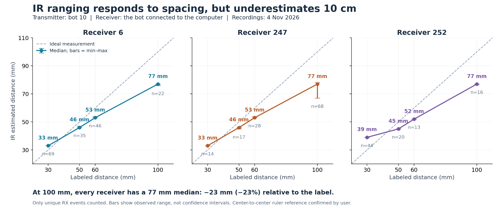
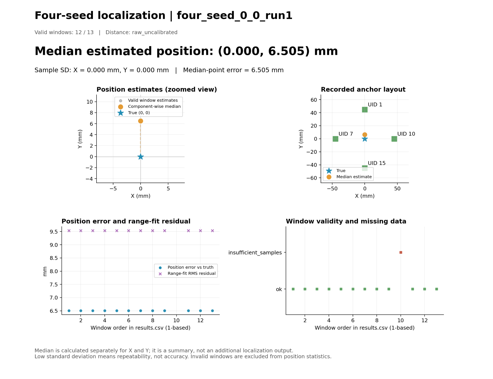
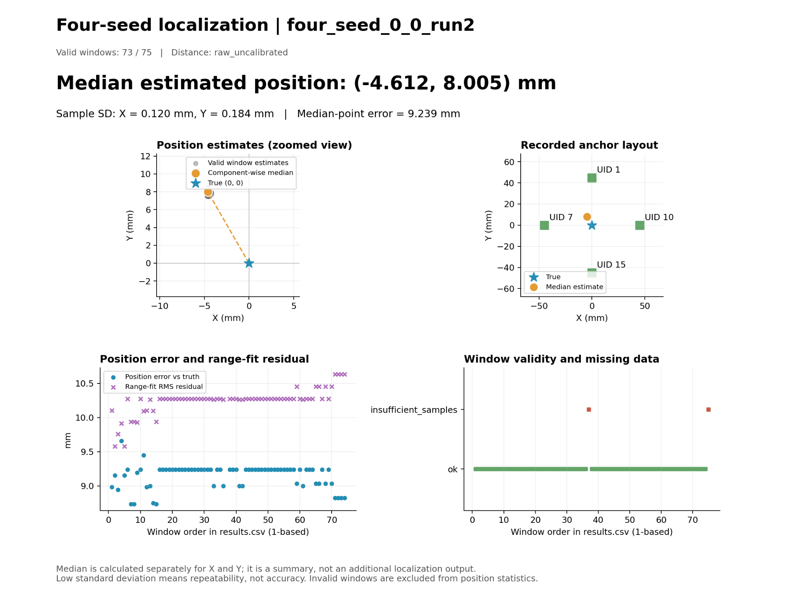
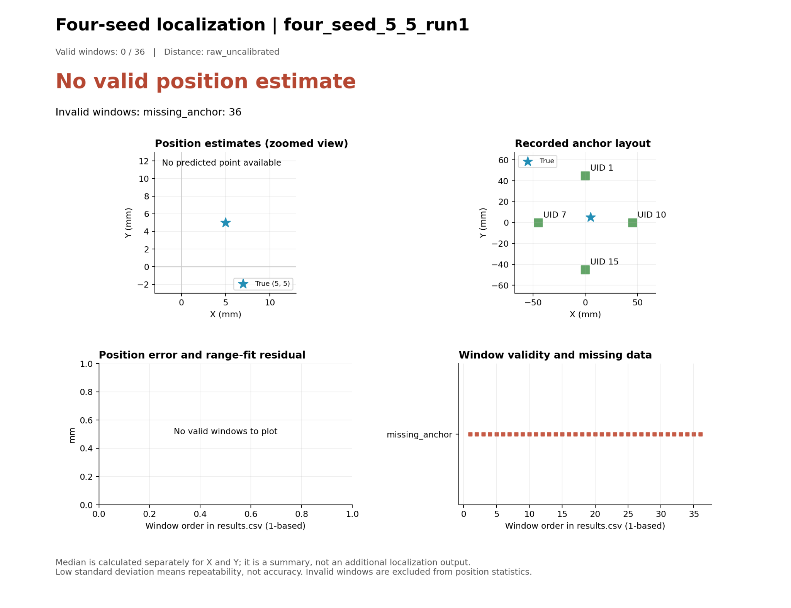
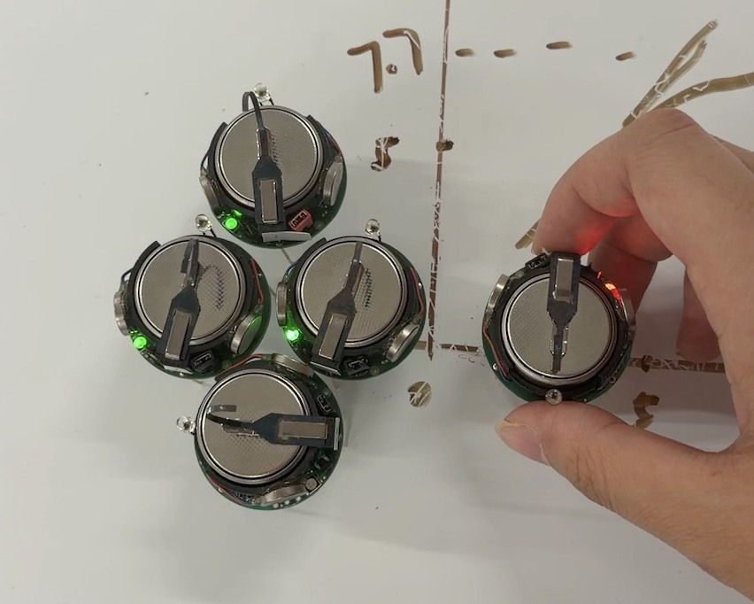
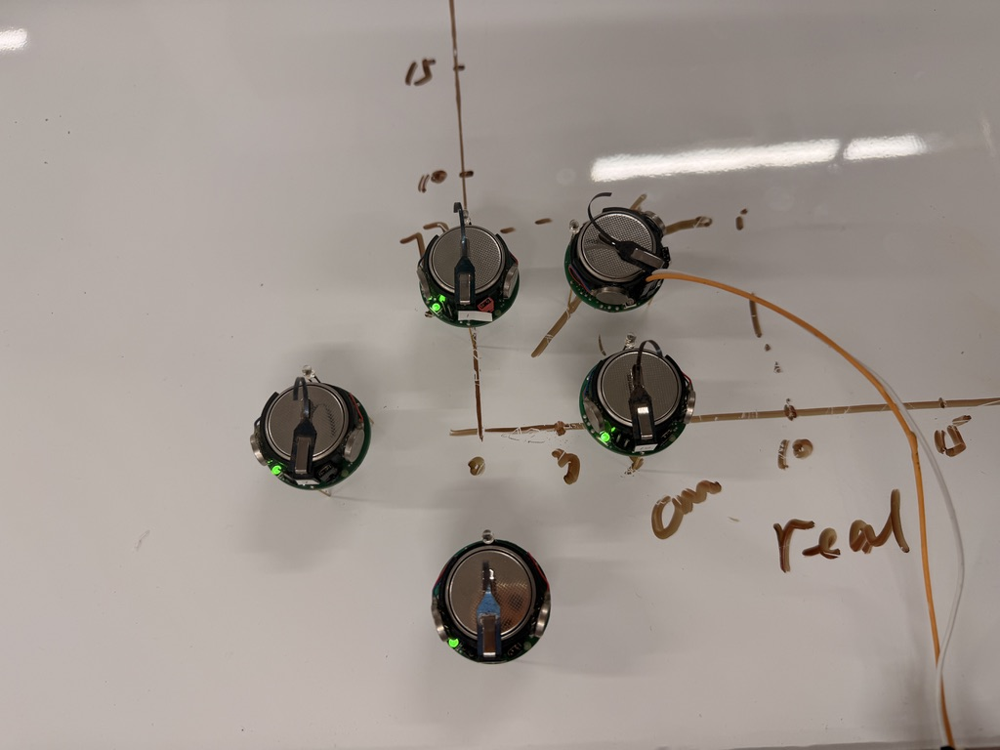

# Weekly Progress — IR Ranging, Localization, and PCB Planning

## 1. Work Completed This Week

- **IR ranging measurements:** Compared three Kilobot receivers (UID 6, 247, 252) at labeled distances of 30, 50, 60, and 100 mm.
  - Measurements generally increased with spacing but underestimated longer distances.
  - At 100 mm, all three receivers reported a median of **77 mm (−23% error)**.
  - These recordings were collected on November 4 and included in this week's analysis.

  

- **Four-anchor localization:** Used four anchors (1, 7, 10, 15) to estimate the target robot's position from **raw, uncalibrated IR ranges**.
  - Target at **(0, 0) mm**, run 1: **12/13 valid windows**; median-point error **6.505 mm**.
  - Target at **(0, 0) mm**, run 2: **73/75 valid windows**; median estimate **(−4.612, 8.005) mm**; median-point error **9.239 mm**
  - Target at **(5, 5) mm**: **0/36 valid windows** (missing anchor measurements).
  - Stable estimates do not necessarily indicate accurate positioning; both runs at the origin showed offsets.

  
  
  
  

- **Diamond-shaped path experiment:**
  - Investigated a 2025 decentralized swarm localization / formation paper and attempted a diamond-shaped path-following behavior on physical Kilobots.
  - **Not successful:** the robot did not reliably follow the intended edges and turns.
  - Possible contributors: motor calibration, inconsistent turning, and distance-based control; causes still need to be isolated

  

## 2. Problems and Questions

- **IR ranging:** Systematic underestimation at longer distances; calibration needed.
- **Localization:** Missing anchor readings can make the position estimate unavailable.
- **Position accuracy:** Repeated estimates can be consistent but biased; raw ranging measurements are not yet calibrated.
- **Diamond path:** Poor trajectory tracking; need to investigate turning control, motor calibration, and thresholds.

## 3. Next Steps

- Calibrate IR distance measurements and repeat four-anchor localization tests.
- Investigate missing-anchor data and improve localization robustness.
- Refine and test the diamond-shaped path-following algorithm.
- Compare candidate processors for Kilobot V2 using wireless networking, GPIO, ADC, PWM, size, and power requirements.

## 4. Thursday Meeting — November 12

### Kilobot V2 PCB Requirements 

| Component | Requirement / Discussion |
|---|---|
| **Processor** | Small, low-power MCU with integrated wireless networking; Arm or RISC-V is acceptable. |
| **Wireless communication** | Address individual robots, broadcast commands, support debugging, and evaluate scalability to approximately 100 robots. |
| **IR receivers** | At least 3, potentially up to 8, for bearing estimation and local IR communication; exact count is not decided. |
| **IR transmitters** | Potentially up to 8 for directional local IR communication; number and driver architecture remain open. |
| **Ambient light sensors** | Approximately 3–4 spatially separated sensors for sensing light gradients. |
| **Motor control** | Two motor channels/drivers; plan for ~6 control signals, at least 2 of them PWM (actual count depends on driver). |
| **Feedback / debugging** | RGB LED and improved wireless status / debug access. |
| **GPIO / interfaces** | Check usable GPIO, ADC, PWM, and I²C; consider external interface / driver ICs to reduce MCU pin requirements. |
| **PCB size** | Stay close to the current Kilobot footprint; only modest size increases. |
| **Modularity** | Allow future interchangeable / add-on hardware modules. |
| **Power / charging** | Battery powered; legless mechanics and inductive charging are possibilities, not final decisions. |

